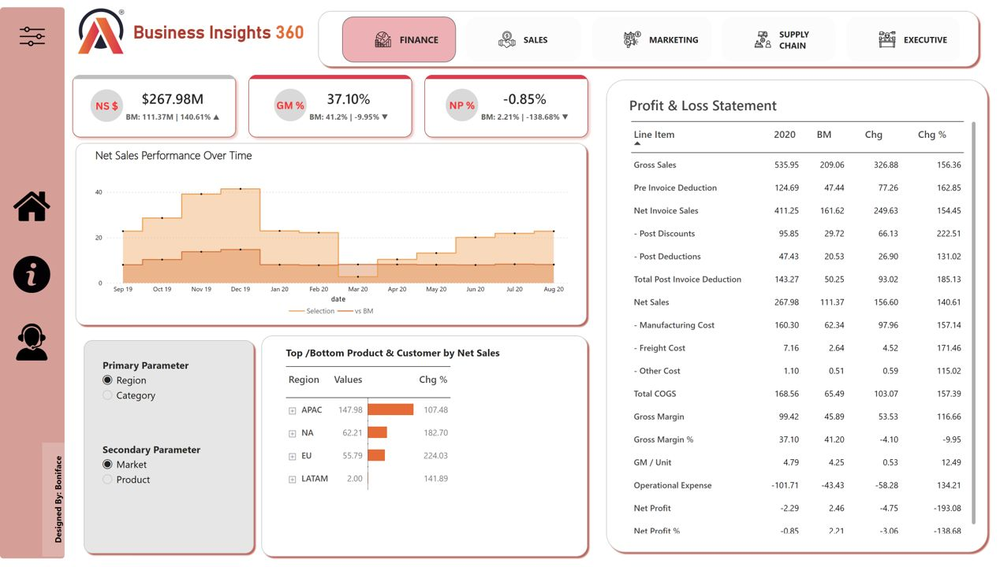
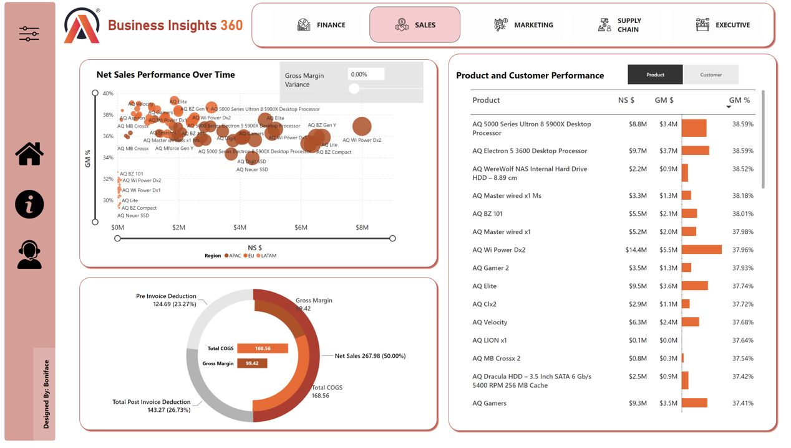
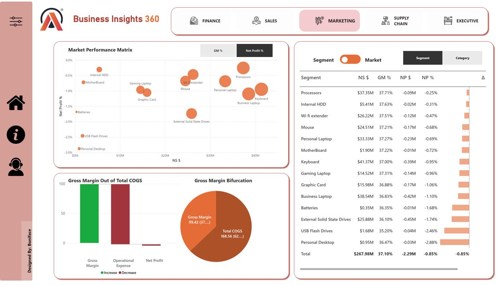
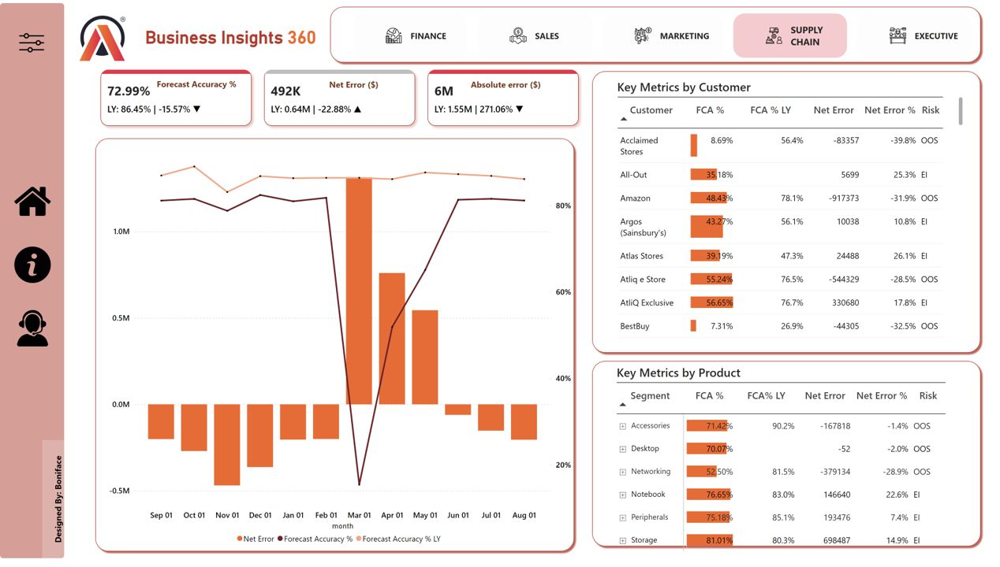
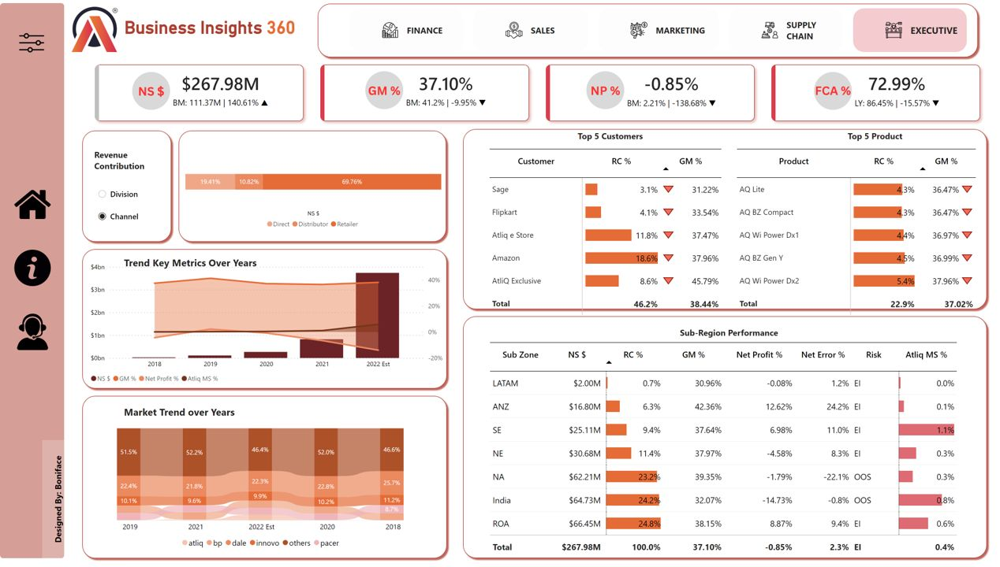

# Business-Intelligence-Analytics-Using-Power-BI
A comprehensive Power BI Business Intelligence project designed to help AtliQ Hardware transform its Excel-based reporting into an integrated, data-driven decision-making solution.

## 📌 Problem Statement

AtliQ Hardware has expanded its business across multiple countries, making its business operations and analytical requirements increasingly complex. Despite its rapid growth, the company continues to rely heavily on Excel files for data analysis and reporting.

The lack of effective business intelligence and timely insights contributed to a significant business loss in Latin America, highlighting the need for a robust and scalable analytics solution.

## 🎯 Project Objective

To empower AtliQ Hardware with a dynamic and integrated business intelligence solution that enhances decision-making across multiple business functions.

This project aims to transition AtliQ from traditional Excel-based analytics to an interactive **Power BI dashboard solution**, enabling stakeholders to monitor performance, identify trends, evaluate profitability, and make informed business decisions.

## 🛠️ Tools & Technologies

- **Power BI Desktop** – Interactive dashboards and visualizations
- **Power Query** – Data cleaning and transformation
- **DAX (Data Analysis Expressions)** – Measures and business calculations
- **Data Modeling** – Relationships and analytical data models
- **Microsoft Excel** – Source data and initial analysis

## 📊 Project Dashboards
[Dashboard](https://app.powerbi.com/view?r=eyJrIjoiYWExYzc0MTAtODU3NS00OTZhLWEwZjEtYzBjNTRjNjViODUwIiwidCI6ImM2ZTU0OWIzLTVmNDUtNDAzMi1hYWU5LWQ0MjQ0ZGM1YjJjNCJ9&pageName=ReportSectiona34025cf011882ba6818)

### 1. 💰 Finance Dashboard

Provides a comprehensive view of the company's financial performance through key financial metrics.

**Key Insights:**
- Profit and Loss (P&L) analysis
- Net Sales performance
- Gross Margin and Gross Margin Percentage
- Net Profit and Net Profit Percentage
- Financial performance trends and comparisons

**Business Value:** Helps finance teams evaluate profitability, track financial performance, and identify areas for improvement.

### 2. 📈 Sales Dashboard

Analyses sales performance across customers and products to identify revenue drivers and business opportunities.

**Key Insights:**
- Net Sales by customer and product
- Top-performing customers and products
- Sales performance trends
- Unit economics and sales contribution
- Customer and product-level performance comparisons

**Business Value:** Enables sales teams to identify profitable customers, optimise product strategies, and improve sales performance.

### 3. 🌍 Marketing Dashboard

Evaluates marketing and market performance across different regions, products, and customer segments.

**Key Insights:**
- Regional and market-level performance
- Product and market profitability
- Gross Margin Percentage analysis
- Revenue contribution across markets
- Identification of high-performing and underperforming markets

**Business Value:** Helps marketing teams optimise market strategies, evaluate profitability, and identify opportunities for growth.

### 4. 📦 Supply Chain Dashboard

Provides visibility into inventory planning, demand forecasting, and supply chain performance.

**Key Insights:**
- Inventory and stock-level monitoring
- Forecast Accuracy analysis
- Net Error analysis
- Customer-level supply chain performance
- Demand forecasting and inventory planning

**Business Value:** Supports better inventory management, improves forecasting accuracy, and helps reduce stock shortages and excess inventory.

### 5. 👔 Executive Dashboard

Offers senior management a consolidated overview of the company's overall business performance.

**Key Insights:**
- Revenue and sales performance
- Customer and product contribution
- Financial performance indicators
- Market and regional performance
- High-level business KPIs and trends

**Business Value:** Enables executives to monitor organisational performance, identify strategic opportunities, and make data-driven decisions.

## 🔍 Key Business Outcomes

The integrated dashboard solution helps AtliQ Hardware to:

- Replace fragmented Excel-based reporting with centralised analytics.
- Monitor key performance indicators across business functions.
- Identify profitable customers, products, and markets.
- Improve financial visibility and profitability analysis.
- Strengthen demand forecasting and inventory management.
- Enable faster, evidence-based business decisions.
- Support scalable, data-driven business growth.

## 🧠 Skills Demonstrated

- Data Cleaning and Transformation
- Data Modeling and Relationship Management
- DAX Measures and Calculated Metrics
- KPI Development
- Interactive Dashboard Design
- Business Performance Analysis
- Financial and Profitability Analysis
- Sales and Supply Chain Analytics
- Data-Driven Decision-Making

